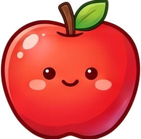
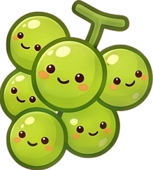
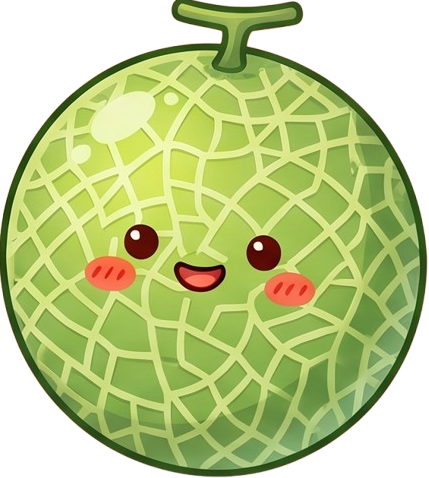
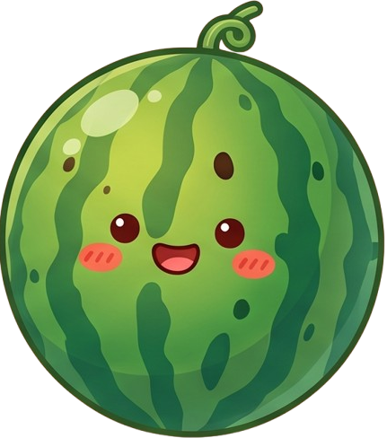

# 🍉 WMgame

**C# WinForms로 만든 수박게임 클론**

 →  →  →  →  →  →  →  →  → 

## 📌 소개
같은 과일끼리 부딪히면 한 단계 큰 과일로 합쳐지는 '수박게임'입니다.
물리 엔진 없이 **중력 · 충돌 · 합체 로직을 직접 구현**했습니다.

## ✨ 구현 내용
- 🖱 마우스 클릭 위치에서 과일 낙하
- 🌍 중력 · 원형 충돌 · 벽/바닥 경계 처리
- 🔀 같은 단계 과일 충돌 시 **합체 → 다음 단계 생성**, 단계별 점수 가산
- 🎲 다음 과일은 낮은 단계 중 랜덤 생성
- ⚠️ 위험선 초과 상태가 일정 시간 지속되면 게임 오버, **최고 점수 기록**

## ▶️ 실행 방법
Visual Studio 2022에서 `WMgame.sln` 열고 `F5`
